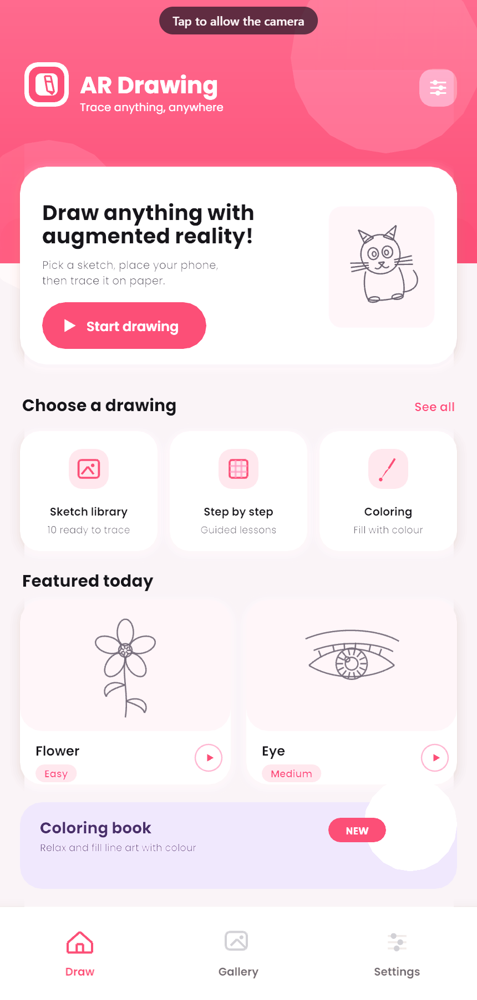
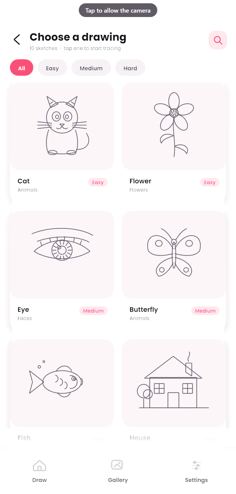
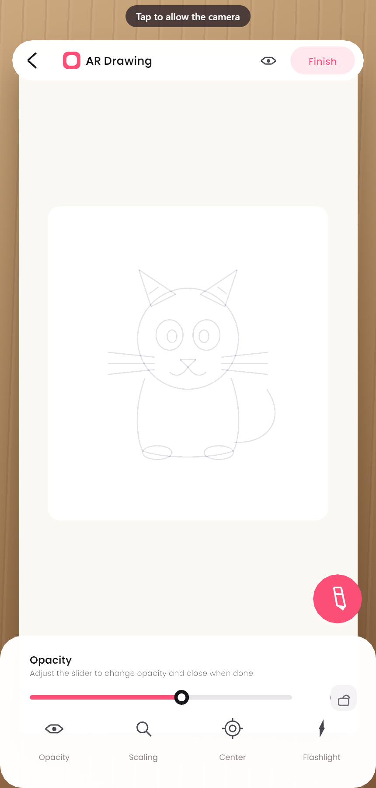

# AR Drawing — browser edition

A tracing and sketching studio that runs in a phone browser. It is a rebuild of
**AR Drawing: Sketch & Paint 5.2.8** (Android) written from scratch in Rust with
[macroquad](https://macroquad.rs), and compiled to WebAssembly.

The point of the app: put a translucent line drawing over the sheet of paper in
front of you — through the phone camera, or on the drawn desk fallback — then
trace it with a real pencil, or with your finger using the built-in brushes.

> **Live app: <https://irishfan3124.github.io/ar-drawing-web/>**
> Open it on the phone, not on this PC. The camera only works on an `https://`
> page, so use the Pages URL rather than a local file.

| Home | Library | Tracing |
| --- | --- | --- |
|  |  |  |

## What it does

- **Draw tab** — hero "Start drawing" card, quick entries, featured sketches,
  promo banner; bottom tabs Draw / Gallery / Settings.
- **Sketch library** — 10 built-in line drawings across Animals, Faces, Places,
  Objects and Flowers, filterable by Easy / Medium / Hard.
- **Trace screen** — a translucent white sheet holding the sketch sits over the
  paper. Drag it to move, pinch or use the **Scaling** presets (0.5× / 1.0× /
  2.0×) to resize, **Center** to recentre, **Opacity** to fade it (50% start,
  quick 50/100 toggle), the lock button to freeze it. The eye in the top bar
  hides every control for a clean tracing view. **Finish** saves the result.
- **Finger drawing** — the pink pencil button opens the tray: Pencil, Marker,
  Brush and Eraser, ten colours, size 1–20, Undo, Redo, Clear.
- **Step by step** — a 1/4 · 2/4 · 3/4 · 4/4 pill reveals one stage at a time.
- **My drawings** — finished sketches with their strokes, opacity and age.

## Run it on a phone

1. Open the Pages URL in Chrome (Android) or Safari (iOS).
2. Allow the camera when asked — that is what turns the screen into the live AR
   view. If you refuse, the app falls back to a drawn desk-and-paper view and
   everything except the camera preview still works.
3. Pick a sketch, then drag the sheet into place over your paper and trace.

`docs/AR-Drawing.html` is the same app as one self-contained file (wasm inlined),
handy if you want to drop it on a USB stick or any other static host.

## Run it on a PC

```powershell
cargo run                 # desktop window
cargo run -- --screenshot out.png   # 120 frames, save a PNG, exit
cargo run -- --self-test out.json   # scripted session, writes pass/fail steps
```

## Rebuild the web build

```powershell
rustup target add wasm32-unknown-unknown
cd web
.\build-web.ps1           # writes web/index.html and web/AR-Drawing.html
```

Then copy `index.html`, `ar_drawing.wasm` and `mq_js_bundle.js` into `docs/`.

## Layout

| Path | What it is |
| --- | --- |
| `src/main.rs` | screens, flow, input |
| `src/ui.rs` | the phone canvas, type, icons, widgets |
| `src/art.rs` | the ten line drawings, each split into four steps |
| `docs/` | the published site (GitHub Pages serves this folder) |
| `web/` | the web build script and page template |
| `MECHANICS.md`, `mechanics.json` | every number and where it came from |
| `CREDITS.md` | attribution, licences |

## Known limits

- The live camera preview is not drawn by macroquad; the page puts a camera
  `<video>` behind a transparent canvas. The desktop build shows a drawn desk and
  paper instead.
- Photo upload, AI photo-to-sketch, the lesson library, the colouring book and the
  subscription screens are not reproduced — ten ready-made line sketches stand in
  for the picture library.
- The gallery lasts for the session; there is no account or cloud album.

See [CREDITS.md](CREDITS.md) for what came from the original and what is new. The
build is for personal use; the original app remains the property of its publisher.
